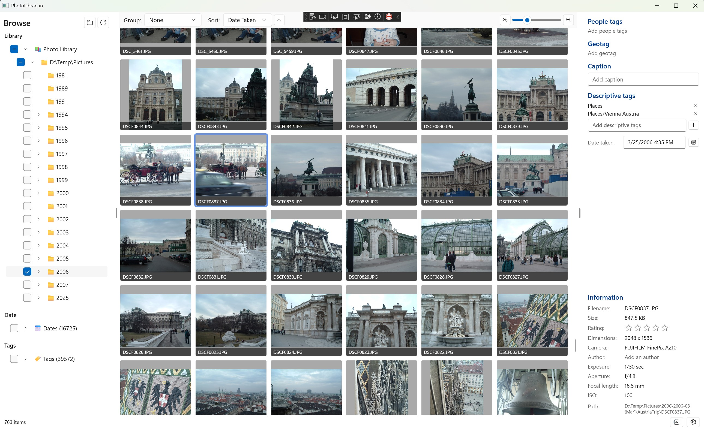

#  PhotoLibrarian

A fast, strictly local (no cloud service) photo library manager for Windows — built with WinUI 3 and Win2D.

PhotoLibrarian is designed to handle real photo libraries (tens of thousands of images, including RAW + video) without lock-up, with a single-purpose UI inspired by the late, well-loved **Windows Live Photo Gallery**. Unlike other solutions out there with hidden databases or local web servers, this is purely a local app. Nothing hidden or tied to a cloud service. Your photos and data stay on your computer.



> **Premise:** your edits stay with your images.
> Ratings, captions, tags, and capture dates are written **directly into the image file**, so moving a photo to another drive, computer, or app keeps every edit intact. No proprietary catalog, no parasitic sidecars (for the formats that can hold their own metadata; RAW originals use standard XMP sidecars).

---

## Features at a glance

Full descriptions are in [docs/FEATURES.md](docs/FEATURES.md).

- **Browse** a custom virtualized grid (18 000+ items per folder) with folder, date, people, tag, flag and color-label navigation, remembered layout, and fast local full-text [search](docs/SEARCH.md).
- **Organize** with multi-select editing of ratings, captions, hierarchical tags, capture dates, geotags, flags and color labels; batch rename; batch resize/export; photo import.
- **Edit** with a real-time Win2D editor, tone curves, spot retouch, RAW development, shared undo/redo and original backups — see [advanced editing](docs/ADVANCED-EDITING.md), [spot retouch](docs/SPOT-RETOUCH.md) and [edit history](docs/EDIT-HISTORY.md).
- **Compare and review** photos side by side or in a grid ([Compare](docs/COMPARE-AND-SURVEY.md)), find [duplicates](docs/DUPLICATE-DETECTION.md), and clean up people tags.
- **Create** with [Photo Fuse](docs/PHOTO-FUSE.md), [panoramas](docs/PANORAMA-STITCHING.md), pixel [motion photos](docs/MOTION-PHOTOS.md), and simple [video editing and stabilization](docs/VIDEO-STABILIZATION.md).
- **Opt-in local AI**: face detection and automatic content tags using checksum-pinned ONNX models — see [models and tagging](docs/MODELS-AND-TAGGING.md).
- **Portable metadata**: embedded in the photo wherever the format allows, XMP sidecars only where it doesn't, and a SQLite index that is only a cache. See the [metadata policy](docs/ARCHITECTURE.md#metadata-handling-philosophy).

Keyboard and mouse shortcuts are listed in [docs/KEYBOARD.md](docs/KEYBOARD.md).

---

## Status

Active personal project — usable for daily browsing, tagging, and rating today. See the [Roadmap](#roadmap) for what's planned.

---

## Architecture

```
┌───────────────────────────────────────────────────────────────┐
│  PhotoLibrarian            (WinUI 3 app, Win2D, MVVM)         │
│  ┌─────────────────┬──────────────────┬────────────────────┐  │
│  │  FolderNav      │   ImageGrid      │   MetadataPanel    │  │
│  │  (Library/      │   (custom virt.  │   (multi-select    │  │
│  │   Date/People/  │    Canvas grid)  │    aware editor)   │  │
│  │   Tag trees,    │                  │                    │  │
│  │   union filter) │   ImageViewer    │   ImageEditor      │  │
│  │                 │   overlay        │   (Win2D)          │  │
│  └─────────────────┴──────────────────┴────────────────────┘  │
└───────────────┬───────────────────────────────────────────────┘
                │
┌───────────────▼───────────────────────────────────────────────┐
│  PhotoLibrarian.Core        (services + data layer)           │
│  • EmbeddedMetadataWriter   – in-place EXIF/XMP via WIC       │
│  • MetadataWriter / Reader  – rating, caption, date, tags     │
│  • FolderScannerService     – fast directory walk             │
│  • LibraryIndexingService   – background indexer              │
│  • ThumbnailService         – Windows shell thumbnail cache   │
│  • CacheDatabase            – SQLite metadata cache           │
│  • ImageEditService         – Win2D effect graph application  │
└───────────────────────────────────────────────────────────────┘
                │
┌───────────────▼───────────────────────────────────────────────┐
│  PhotoLibrarian.ML          (face detection, scene tagging)   │
│  • ONNX Runtime + DirectML                                    │
└───────────────────────────────────────────────────────────────┘
```

| Project | Purpose |
|---|---|
| `src/PhotoLibrarian` | WinUI 3 application (views, viewmodels, controls). |
| `src/PhotoLibrarian.Core` | Services, repositories, models. No UI dependencies (other than WIC). |
| `src/PhotoLibrarian.ML` | ML pipelines (face detection, scene tagging) via ONNX Runtime. |
| `src/PhotoLibrarian.Inference` | Shared zero-shot scoring and reference-matching image preprocessing. |
| `src/PhotoLibrarian.Tests` | xUnit + Moq test suite. |
| `tools/PhotoLibrarian.ModelBench` | Standalone ONNX model comparison and scoring utility. |

The [cross-feature architecture map](docs/ARCHITECTURE.md#cross-feature-architecture-map) lists the shared owner for each concern (metadata, backups, rendering, dialogs, settings, ...).

---

## Getting started

Requires Windows 10 1809+, the .NET 8 SDK, and Visual Studio 2022 17.14+ (or 2026) with the Windows App SDK and C++ desktop workloads.

```powershell
git clone https://github.com/dunclaw/PhotoLibrarian.git
cd PhotoLibrarian
msbuild PhotoLibrarian.slnx /restore /m /p:Configuration=Release /p:Platform=x64
```

Use a Visual Studio Developer PowerShell (the solution contains native VC projects, so `dotnet build` is not enough). See [docs/BUILD.md](docs/BUILD.md) for prerequisites, native dependencies and CI/Store packaging.

On first run, click the gear icon → **Manage folders** and add the folders to index. Automatic tagging is off by default; see [docs/MODELS-AND-TAGGING.md](docs/MODELS-AND-TAGGING.md).

---

## Documentation

| Topic | Page |
|---|---|
| All features | [docs/FEATURES.md](docs/FEATURES.md) |
| Architecture, conventions, metadata policy | [docs/ARCHITECTURE.md](docs/ARCHITECTURE.md) |
| Build, packaging, contributing | [docs/BUILD.md](docs/BUILD.md), [docs/STORE-RELEASE.md](docs/STORE-RELEASE.md) |
| Models and automatic tagging | [docs/MODELS-AND-TAGGING.md](docs/MODELS-AND-TAGGING.md), [MODEL-ASSETS.md](MODEL-ASSETS.md) |
| Keyboard & mouse | [docs/KEYBOARD.md](docs/KEYBOARD.md) |
| Copilot / contributor guidelines | [.github/copilot-instructions.md](.github/copilot-instructions.md) |

---

## Roadmap

The roadmap lives in [GitHub issues](https://github.com/dunclaw/PhotoLibrarian/issues), organised into seven milestones derived from an audit against a Windows Live Photo Gallery feature inventory (issues labelled `pg-parity`).

| Milestone | Theme |
|-----------|-------|
| [M1: Finish what is started](https://github.com/dunclaw/PhotoLibrarian/milestone/1) | Close out half-wired features |
| [M2: Find & Filter](https://github.com/dunclaw/PhotoLibrarian/milestone/2) | Flags, rating filters, full-text search, untagged view |
| [M3: People & Faces](https://github.com/dunclaw/PhotoLibrarian/milestone/3) | Face UI, person tags, batch review |
| [M4: Editing Suite](https://github.com/dunclaw/PhotoLibrarian/milestone/4) | Straighten, red-eye, retouch, effects, histogram, undo |
| [M5: Output & Sharing](https://github.com/dunclaw/PhotoLibrarian/milestone/5) | Slideshow, print, batch resize/export, share |
| [M6: Library Hygiene](https://github.com/dunclaw/PhotoLibrarian/milestone/6) | Batch rename, camera import, duplicates, sidecar migration |
| [M7: Geo & Create](https://github.com/dunclaw/PhotoLibrarian/milestone/7) | Geotags, map view, panorama, photo fuse |

Photo Gallery features that depended on retired services (cloud publishing, Bing geocoding, Order Prints, DVD Maker) are deliberately out of scope.

---

## Contributing

This is a personal project but PRs are welcome. Please keep changes scoped, run the solution build, and follow the existing style. See [docs/BUILD.md](docs/BUILD.md) and [.github/copilot-instructions.md](.github/copilot-instructions.md).

---

## License

[MIT](LICENSE) © 2026 Duncan Lawler

---

## Acknowledgements

- **Windows Live Photo Gallery** — RIP. The reference UX target.
- [MetadataExtractor](https://github.com/drewnoakes/metadata-extractor-dotnet), [XmpCore](https://github.com/drewnoakes/xmp-core-dotnet), [Win2D](https://github.com/microsoft/Win2D), and the [Community Toolkit MVVM](https://github.com/CommunityToolkit/dotnet) libraries do a lot of heavy lifting.
- [ONNX Model Zoo](https://github.com/onnx/models) provides the pinned MobileNetV2 and EfficientNet-Lite4 legacy comparison profiles. RAM++ assets are user supplied and are not included or downloaded by PhotoLibrarian.
